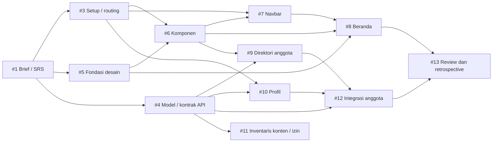

# Sprint 1 — dependency map dan readiness audit

Snapshot GitHub 25 November 2026 sebelum perubahan pekerjaan Adam; bukan komitmen planning aktual. Semua 13 issue berstatus Todo, High, Blocked No; #13 size S, lainnya M. Criteria saat audit masih generik dan perlu refinement. DoR tidak dinyatakan lulus hanya karena metadata lengkap; #1 dapat dimulai dengan sumber eksplisit sebagai draft, persetujuan masih pending.

| Issue | PIC | Priority / Size | Status | Blocked saat audit | Readiness awal |
| --- | --- | --- | --- | --- | --- |
| [#1](https://github.com/adamyudhistiramuhtar-byte/KELOMPOK-1-UI-LANJUT/issues/1) [K1-01] Project Brief, SRS, dan pemetaan kebutuhan | Adam Yudhistira Muhtar | High/M | Todo | No | Ya |
| [#2](https://github.com/adamyudhistiramuhtar-byte/KELOMPOK-1-UI-LANJUT/issues/2) [K1-02] Rencana Scrum dan GitHub Flow | Adam Yudhistira Muhtar | High/M | Todo | No | Belum; dependency atau kriteria perlu refinement |
| [#3](https://github.com/adamyudhistiramuhtar-byte/KELOMPOK-1-UI-LANJUT/issues/3) [K1-03] Setup aplikasi dan routing dasar | Alexius Prasta Nugraha | High/M | Todo | No | Belum; dependency atau kriteria perlu refinement |
| [#4](https://github.com/adamyudhistiramuhtar-byte/KELOMPOK-1-UI-LANJUT/issues/4) [K1-04] Model data dan kontrak API | Panji Laryan | High/M | Todo | No | Belum; dependency atau kriteria perlu refinement |
| [#5](https://github.com/adamyudhistiramuhtar-byte/KELOMPOK-1-UI-LANJUT/issues/5) [K1-05] Design tokens dan fondasi visual | Sindi Rahmawati | High/M | Todo | No | Belum; dependency atau kriteria perlu refinement |
| [#6](https://github.com/adamyudhistiramuhtar-byte/KELOMPOK-1-UI-LANJUT/issues/6) [K1-06] Komponen UI reusable | Alexius Prasta Nugraha | High/M | Todo | No | Belum; dependency atau kriteria perlu refinement |
| [#7](https://github.com/adamyudhistiramuhtar-byte/KELOMPOK-1-UI-LANJUT/issues/7) [K1-07] Navbar dan navigasi responsif | Alexius Prasta Nugraha | High/M | Todo | No | Belum; dependency atau kriteria perlu refinement |
| [#8](https://github.com/adamyudhistiramuhtar-byte/KELOMPOK-1-UI-LANJUT/issues/8) [K1-08] Beranda dan tautan proyek unggulan | Adam Yudhistira Muhtar | High/M | Todo | No | Belum; dependency atau kriteria perlu refinement |
| [#9](https://github.com/adamyudhistiramuhtar-byte/KELOMPOK-1-UI-LANJUT/issues/9) [K1-09] Kartu anggota dan direktori Tim | Sindi Rahmawati | High/M | Todo | No | Belum; dependency atau kriteria perlu refinement |
| [#10](https://github.com/adamyudhistiramuhtar-byte/KELOMPOK-1-UI-LANJUT/issues/10) [K1-10] Profil individu dasar | Marza | High/M | Todo | No | Belum; dependency atau kriteria perlu refinement |
| [#11](https://github.com/adamyudhistiramuhtar-byte/KELOMPOK-1-UI-LANJUT/issues/11) [K1-11] Inventaris konten dan persetujuan publikasi | Muhammad Indra | High/M | Todo | No | Belum; dependency atau kriteria perlu refinement |
| [#12](https://github.com/adamyudhistiramuhtar-byte/KELOMPOK-1-UI-LANJUT/issues/12) [K1-12] Integrasi sumber data alur anggota | Panji Laryan | High/M | Todo | No | Belum; dependency atau kriteria perlu refinement |
| [#13](https://github.com/adamyudhistiramuhtar-byte/KELOMPOK-1-UI-LANJUT/issues/13) [K1-13] Review dan retrospective Sprint 1 | Adam Yudhistira Muhtar | High/S | Todo | No | Belum; dependency atau kriteria perlu refinement |

Jalur berisiko menuju demonstrasi: #1 → #3/#5 → #6 → #7 → #8 → #13; dan #1 → #4 → #9/#10 → #12 → #13. Ini adalah **kandidat critical path berdasarkan dependency, bukan hasil perhitungan durasi**; ukuran S/M bukan durasi. #4, #5, dan persiapan konten dapat berjalan paralel setelah bahan #1 siap; #9/#10 dapat paralel setelah dependency masing-masing siap. Ketersediaan konten/izin #11 adalah risiko bagi integrasi meskipun tidak tercantum sebagai dependency formal #12.

Hambatan: stack/router #3 dan fondasi desain #5 belum tersedia; tombol #6/navbar #7 belum tersedia; identitas anggota belum terverifikasi; API dan konten memerlukan kesepakatan/izin. Perubahan PIC dan sprint commitment memerlukan kesepakatan tim.

## Pembaruan 25 November — native dependency

GitHub native dependency telah dicatat untuk #3/#5 → #6; #3/#6 → #7; #5/#6/#7 → #8; #4/#6 → #9; #3/#4 → #10; #4/#9/#10 → #12; #8/#12 → #13. #3 juga merupakan prasyarat teknis implisit #8 melalui #6/#7. Dependency native mengungkap urutan integrasi; field Blocked tetap digunakan hanya untuk hambatan aktual. Persiapan #2–#5 dan inventaris #11 dapat berjalan berdasarkan kontrak sementara tanpa menunggu SRS final merge. Dependency #4 → #11 hanya referensi koordinasi model, bukan larangan memulai inventaris. Kandidat jalur berisiko bukan critical path numerik.
