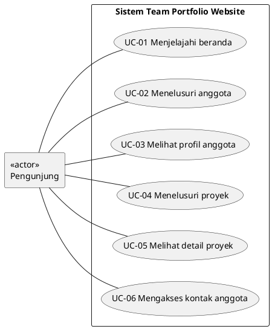

# Use case — DRAFT / PERLU KONFIRMASI

Model usulan berdasarkan FR sementara; SRS asli yang mungkin memuat enam UC belum tersedia. Aktor `«actor» Pengunjung` berada di luar satu boundary. Sistem API eksternal belum dipilih sehingga tidak dimodelkan sebagai aktor spesifik. Include/extend telah dievaluasi; tidak ditemukan hubungan wajib/kondisional antar tujuan yang perlu dimodelkan, sehingga tidak dipaksakan.

Diagram di atas berupa sumber PlantUML; render visual belum diverifikasi.

## UC-01 — Menjelajahi beranda

| Atribut | Deskripsi |
| --- | --- |
| Use Case Name / ID | Menjelajahi beranda / UC-01 |
| Priority / Actor | High (usulan) / Pengunjung |
| Description | Pengunjung mencapai tujuan menjelajahi beranda melalui /. |
| Trigger | Pengunjung membuka beranda. |
| Preconditions | Website dan route terkait tersedia; data yang ditampilkan telah disetujui. |
| Normal Course | 1. Pengunjung membuka beranda. 2. Sistem menampilkan identitas, hero, CTA dan bila tersedia tautan proyek unggulan. 3. Tautan menuju Tim atau Proyek dipilih. |
| Sub Flows | S-1 (langkah 3): Tautan menuju Tim atau Proyek dipilih; alur selesai pada tujuan yang dipilih. |
| Alternate Flows | A-1 (langkah 2): Tautan unggulan belum tersedia: tidak ditampilkan; alur berakhir atau menunggu pilihan pengunjung. |
| Exceptional Flows | E-1 (langkah 2): Route tujuan belum tersedia: catat sebagai kegagalan integrasi; alur berhenti atau pulih sesuai respons. |
| Postconditions | Sukses: informasi/tujuan yang dipilih ditampilkan; gagal: informasi sukses tidak diklaim dan pengunjung menerima respons relevan. |
| Business Rules | BR-01–BR-06 jika relevan; konten personal harus disetujui. |
| FR Mapping | FR-01, FR-02, FR-03 |
| NFR Mapping | NFR-01, NFR-05, NFR-06, NFR-07 |
| Sumber | Instruksi pengguna; belum disetujui tim. |

## UC-02 — Menelusuri anggota

| Atribut | Deskripsi |
| --- | --- |
| Use Case Name / ID | Menelusuri anggota / UC-02 |
| Priority / Actor | High (usulan) / Pengunjung |
| Description | Pengunjung mencapai tujuan menelusuri anggota melalui /team. |
| Trigger | Pengunjung memilih Tim. |
| Preconditions | Website dan route terkait tersedia; data yang ditampilkan telah disetujui. |
| Normal Course | 1. Pengunjung memilih Tim. 2. Sistem menampilkan enam kartu anggota yang tersedia dan disetujui. 3. Pengunjung memilih satu kartu; sistem membuka profil terkait. |
| Sub Flows | S-1 (langkah 3): Pengunjung memilih satu kartu; sistem membuka profil terkait; alur selesai pada tujuan yang dipilih. |
| Alternate Flows | A-1 (langkah 2): Data belum lengkap: tampilkan kondisi yang sesuai; alur berakhir atau menunggu pilihan pengunjung. |
| Exceptional Flows | E-1 (langkah 2): Data gagal diambil: tampilkan pesan yang sesuai; alur berhenti atau pulih sesuai respons. |
| Postconditions | Sukses: informasi/tujuan yang dipilih ditampilkan; gagal: informasi sukses tidak diklaim dan pengunjung menerima respons relevan. |
| Business Rules | BR-01–BR-06 jika relevan; konten personal harus disetujui. |
| FR Mapping | FR-04, FR-05 |
| NFR Mapping | NFR-01, NFR-05, NFR-06, NFR-07 |
| Sumber | Instruksi pengguna; belum disetujui tim. |

## UC-03 — Melihat profil anggota

| Atribut | Deskripsi |
| --- | --- |
| Use Case Name / ID | Melihat profil anggota / UC-03 |
| Priority / Actor | High (usulan) / Pengunjung |
| Description | Pengunjung mencapai tujuan melihat profil anggota melalui /team/:id. |
| Trigger | Pengunjung memilih profil anggota. |
| Preconditions | Website dan route terkait tersedia; data yang ditampilkan telah disetujui. |
| Normal Course | 1. Pengunjung memilih profil anggota. 2. Sistem menampilkan identitas, kompetensi, karya dan tautan yang tersedia. 3. Pengunjung memilih kembali; sistem membuka Tim. |
| Sub Flows | S-1 (langkah 3): Pengunjung memilih kembali; sistem membuka Tim; alur selesai pada tujuan yang dipilih. |
| Alternate Flows | A-1 (langkah 2): Tautan opsional tidak tersedia: tidak ditampilkan; alur berakhir atau menunggu pilihan pengunjung. |
| Exceptional Flows | E-1 (langkah 2): ID tidak valid: tampilkan pesan dan jalan kembali; alur berhenti atau pulih sesuai respons. |
| Postconditions | Sukses: informasi/tujuan yang dipilih ditampilkan; gagal: informasi sukses tidak diklaim dan pengunjung menerima respons relevan. |
| Business Rules | BR-01–BR-06 jika relevan; konten personal harus disetujui. |
| FR Mapping | FR-06, FR-07, FR-08, FR-16 |
| NFR Mapping | NFR-01, NFR-05, NFR-06, NFR-07 |
| Sumber | Instruksi pengguna; belum disetujui tim. |

## UC-04 — Menelusuri proyek

| Atribut | Deskripsi |
| --- | --- |
| Use Case Name / ID | Menelusuri proyek / UC-04 |
| Priority / Actor | High (usulan) / Pengunjung |
| Description | Pengunjung mencapai tujuan menelusuri proyek melalui /projects. |
| Trigger | Pengunjung membuka Proyek. |
| Preconditions | Website dan route terkait tersedia; data yang ditampilkan telah disetujui. |
| Normal Course | 1. Pengunjung membuka Proyek. 2. Sistem meminta data lalu menampilkan daftar dan kontrol pencarian/filter. 3. Pengunjung memasukkan query atau memilih kategori; sistem memperbarui hasil. |
| Sub Flows | S-1 (langkah 3): Pengunjung memasukkan query atau memilih kategori; sistem memperbarui hasil; alur selesai pada tujuan yang dipilih. |
| Alternate Flows | A-1 (langkah 2): Tidak ada hasil: tampilkan empty state; alur berakhir atau menunggu pilihan pengunjung. |
| Exceptional Flows | E-1 (langkah 2): Request gagal: tampilkan error dan retry; retry memulai request baru; alur berhenti atau pulih sesuai respons. |
| Postconditions | Sukses: informasi/tujuan yang dipilih ditampilkan; gagal: informasi sukses tidak diklaim dan pengunjung menerima respons relevan. |
| Business Rules | BR-01–BR-06 jika relevan; konten personal harus disetujui. |
| FR Mapping | FR-09, FR-10, FR-11, FR-14, FR-15 |
| NFR Mapping | NFR-01, NFR-05, NFR-06, NFR-07 |
| Sumber | Instruksi pengguna; belum disetujui tim. |

## UC-05 — Melihat detail proyek

| Atribut | Deskripsi |
| --- | --- |
| Use Case Name / ID | Melihat detail proyek / UC-05 |
| Priority / Actor | High (usulan) / Pengunjung |
| Description | Pengunjung mencapai tujuan melihat detail proyek melalui /projects/:id. |
| Trigger | Pengunjung memilih proyek. |
| Preconditions | Website dan route terkait tersedia; data yang ditampilkan telah disetujui. |
| Normal Course | 1. Pengunjung memilih proyek. 2. Sistem menampilkan latar, tujuan, fitur, teknologi, visual dan kontribusi. 3. Pengunjung memilih profil kontributor atau kembali ke Proyek. |
| Sub Flows | S-1 (langkah 3): Pengunjung memilih profil kontributor atau kembali ke Proyek; alur selesai pada tujuan yang dipilih. |
| Alternate Flows | A-1 (langkah 2): Tautan demo atau repository tidak tersedia: tidak ditampilkan; alur berakhir atau menunggu pilihan pengunjung. |
| Exceptional Flows | E-1 (langkah 2): ID proyek tidak valid: tampilkan pesan dan jalan kembali; alur berhenti atau pulih sesuai respons. |
| Postconditions | Sukses: informasi/tujuan yang dipilih ditampilkan; gagal: informasi sukses tidak diklaim dan pengunjung menerima respons relevan. |
| Business Rules | BR-01–BR-06 jika relevan; konten personal harus disetujui. |
| FR Mapping | FR-12 |
| NFR Mapping | NFR-01, NFR-05, NFR-06, NFR-07 |
| Sumber | Instruksi pengguna; belum disetujui tim. |

## UC-06 — Mengakses kontak anggota

| Atribut | Deskripsi |
| --- | --- |
| Use Case Name / ID | Mengakses kontak anggota / UC-06 |
| Priority / Actor | High (usulan) / Pengunjung |
| Description | Pengunjung mencapai tujuan mengakses kontak anggota melalui /contact. |
| Trigger | Pengunjung memilih Kontak. |
| Preconditions | Website dan route terkait tersedia; data yang ditampilkan telah disetujui. |
| Normal Course | 1. Pengunjung memilih Kontak. 2. Sistem menampilkan identitas dan kontak yang telah disetujui. 3. Pengunjung memilih tautan kontak yang tersedia. |
| Sub Flows | S-1 (langkah 3): Pengunjung memilih tautan kontak yang tersedia; alur selesai pada tujuan yang dipilih. |
| Alternate Flows | A-1 (langkah 2): LinkedIn tidak tersedia: tidak ditampilkan; alur berakhir atau menunggu pilihan pengunjung. |
| Exceptional Flows | E-1 (langkah 2): Kontak belum diizinkan: tidak ditampilkan; alur berhenti atau pulih sesuai respons. |
| Postconditions | Sukses: informasi/tujuan yang dipilih ditampilkan; gagal: informasi sukses tidak diklaim dan pengunjung menerima respons relevan. |
| Business Rules | BR-01–BR-06 jika relevan; konten personal harus disetujui. |
| FR Mapping | FR-13 |
| NFR Mapping | NFR-01, NFR-05, NFR-06, NFR-07 |
| Sumber | Instruksi pengguna; belum disetujui tim. |
